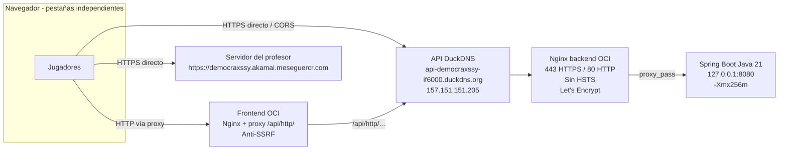

# Guion cronometrado — Demostración y defensa en vivo

## Proyecto

**Cards for democraXSSy** — Curso IF-6000 Redes en los Negocios  
Equipo: **José Andrés** (backend), **Joel** (infraestructura y DevOps) y **Paolo** (frontend, mazos y documentación).

Duración total: **15:00 minutos**.

## Resumen ejecutivo y distribución de tiempos

| Bloque | Responsable principal | Herramienta / vista | Duración |
|---|---|---|---:|
| 1. Diagrama de arquitectura | Joel | Diapositiva o terminal con el diagrama | 1.5 min |
| 2. Terraform, bajar y levantar el backend, despliegue en caliente (antes de jugar) | Joel | Terminal en `infra/` (`servicio.ps1`, `deploy.ps1`); consola OCI | 3.0 min |
| 3. Partida completa por HTTPS directo | Paolo conduce; José Andrés apoya | 4 pestañas del navegador; `Ronda.tsx` | 4.0 min |
| 4. Partida por HTTP vía proxy | Paolo | Ventana/pestañas preparadas para el preset HTTP | 1.5 min |
| 5. Interoperabilidad con el servidor del profesor | José Andrés | Ventana preparada para HTTPS del profesor | 1.5 min |
| 6. Inspección de red y `CallPanel` | José Andrés | DevTools, **Network** y panel en la interfaz | 1.0 min |
| 7. Errores HTTP `409` | José Andrés | UI y PowerShell con `curl.exe` | 1.5 min |
| 8. Preguntas y cierre | Equipo completo | Matriz de preguntas probables | 1.0 min |
| **Total** | | | **15.0 min** |

### Checklist técnico previo a la defensa

- [ ] Preparar tres ventanas o grupos de pestañas independientes:
  - **Grupo A:** cuatro pestañas para la partida HTTPS; todas en Configuración con el preset **Nuestro backend (HTTPS)**.
  - **Grupo B:** cuatro pestañas nuevas para la partida HTTP vía proxy, todas con ese preset seleccionado y listas en Configuración. Joel crea y prepara la partida durante el Bloque 3.
  - **Grupo C:** una o dos pestañas para el servidor del profesor, en Configuración con **Servidor del profesor**.
- [ ] Cada pestaña debe tener su propia sesión de jugador en `sessionStorage`. No reutilizar las pestañas de una partida activa para cambiar de servidor: `App.tsx` muestra `Ronda` mientras haya una partida y no ofrece **Cambiar servidor** desde esa pantalla.
- [ ] Preparar el `.jar` que se va a desplegar y verificar acceso SSH/OCI a la VM `democraxssy-back-e2`; la sesión debe estar lista antes de la defensa.
- [ ] Abrir DevTools en una pestaña de juego, activar **Network**, marcar **Disable cache** y limpiar los registros.
- [ ] Verificar antes de comenzar:

```powershell
curl.exe -I https://api-democraxssy-if6000.duckdns.org/api/salud
curl.exe -I http://api-democraxssy-if6000.duckdns.org/api/salud
```

`HEAD /api/salud` debe responder **200** por ambos esquemas.
- [ ] En `infra/`: `terraform plan` → `No changes`, y `.\servicio.ps1 estado` → `Servicio: active` con `200` por HTTP y HTTPS.
- [ ] Prueba rápida: `node tools/partida-completa.mjs https://api-democraxssy-if6000.duckdns.org` → todo `OK`.

## Bloque 1 — Diagrama de arquitectura (1:30)

**Responsable: Joel.** Abrir la explicación a 0:00. Aclarar que el frontend es la página desde la que el usuario entra, pero las llamadas HTTPS directas del API no pasan por el frontend.



### Guion hablado

- **0:00–0:25 — Joel:** “Cada pestaña representa una sesión de jugador independiente. La llamada directa HTTPS del navegador va al backend, no atraviesa el frontend; el navegador y el servidor coordinan mediante CORS.”
- **0:25–0:55 — Joel:** “Solo la URL HTTP se transforma en una ruta `/api/http/` del frontend. Este proxy anti-SSRF evita el error de Mixed Content y aplica las barreras de Nginx y `nftables`.”
- **0:55–1:20 — Joel:** “El backend vive en una VM OCI `VM.Standard.E2.1.Micro` Always Free. Nginx escucha en 443 y 80, sin redirección obligatoria ni HSTS, y reenvía a Spring Boot en `127.0.0.1:8080`. El servicio configura `-Xmx256m` y `MemoryMax=500M`.”
- **1:20–1:30 — Joel:** “El servidor del profesor es la otra ruta HTTPS directa; su servicio no atiende HTTP, por eso la prueba HTTP se hace contra nuestro backend.”

## Bloque 2 — Infraestructura: Terraform, bajar y levantar el backend, despliegue en caliente (3:00)

**Responsable: Joel.** Va antes de jugar a propósito: bajar, levantar o desplegar reinicia `democraxssy-back` y borra las partidas en memoria. Terminal de VS Code en `infra/`, la consola de OCI abierta y una pestaña del frontend en **Configuración**.

### Cronograma del bloque

- **0:00–0:25 — La infraestructura coincide con el código:**

```powershell
cd infra
terraform plan
```

Esperado: `No changes. Your infrastructure matches the configuration.`

> “La VM, la IP reservada y la configuración (Nginx, Certbot, Java, firewall, servicio con memoria limitada) están definidas en Terraform y cloud-init. Terraform compara OCI con el código y no hay diferencias.”

- **0:25–0:50 — Estado del backend:**

```powershell
.\servicio.ps1 estado
```

Esperado: `Servicio: active`, la memoria usada de 500 MB, `Nginx: active` y `200` por HTTP y por HTTPS.

- **0:50–1:20 — Bajar el backend en caliente:**

```powershell
.\servicio.ps1 detener
```

Esperado: `Servicio: inactive`, `Nginx: active` y **`502`** por HTTP y por HTTPS. En el frontend, pulsar **Nuestro backend (HTTPS)**: la verificación de salud falla y la mesa no se puede verificar.

> “Detuvimos solo el proceso Java. Nginx sigue arriba y responde 502 porque no tiene backend detrás. La VM y la red no se tocan.”

- **1:20–1:50 — Levantarlo de nuevo:**

```powershell
.\servicio.ps1 iniciar
```

Esperado: `Backend arriba: HEAD /api/salud -> 200 (tras ~18 s)` y `200` por HTTP y por HTTPS. En el frontend, volver a verificar: **Mesa Verificada**.

- **1:50–2:40 — Despliegue en caliente de una versión:**

```powershell
powershell -ExecutionPolicy Bypass -File .\deploy.ps1 -Jar ..\backend\target\backend-0.0.1-SNAPSHOT.jar
```

Esperado: `1/3 Subiendo…`, `2/3 Instalando y reiniciando…`, `Backend arriba … 200 (tras ~20 s)`, `Memoria del servicio: ~140 MB` y `3/3 Verificando desde Internet…` con `200` por HTTP y por HTTPS.

> “El script sube el `.jar`, guarda la versión anterior, reinicia el servicio y espera a que responda. Si en 120 s no responde, vuelve solo a la versión anterior (rollback, probado en `infra/evidencia/06-despliegue-y-rollback.txt`).”

- **2:40–3:00 — OCI:** la instancia `democraxssy-back-e2` (`VM.Standard.E2.1.Micro`, Always Free), la IP reservada `157.151.151.205` y las métricas de CPU y memoria. Con 50 partidas de 22 jugadores el servicio no pasó de 169 MB, con un tope de 500 (`infra/evidencia/08-memoria.md`).

**Frase clave:** “La infraestructura es código y no cambia; el backend se baja, se levanta y se actualiza con un comando, verificado por HTTP y HTTPS.”

**Si algo falla:**
- *bad permissions* en la llave: `icacls ssh-keys\democraxssy-back /inheritance:r /grant:r "$($env:USERNAME):R"`.
- Error 401 de Terraform: mostrar `infra/evidencia/05-estado-actual.txt`.
- El despliegue falla: el rollback deja la versión anterior funcionando.
- El guion detallado con las preguntas probables está en `infra/DEMO-despliegue.md`.

## Bloque 3 — Partida completa por HTTPS directo (4:00)

**Responsable: Paolo.** Usar únicamente el Grupo A preparado con **Nuestro backend (HTTPS)**. URL del preset: `https://api-democraxssy-if6000.duckdns.org`.

Usar meta de **1 punto** para que la primera decisión finalice la partida y la pantalla `terminada` muestre al ganador. La meta 2 es una variante si se prioriza mostrar resultado de ronda y rotación del soberano; no intentar hacer ambas variantes dentro de estos cuatro minutos.

### Preparación paralela del Grupo B

Mientras Paolo conduce la partida HTTPS, **Joel prepara la partida HTTP** en las cuatro pestañas del Grupo B. El despliegue ya terminó en el Bloque 2, por lo que la sala no se perderá por un reinicio:

1. En la primera pestaña, seleccionar **Nuestro backend (HTTP vía proxy)**, elegir meta 1 y pulsar **Crear partida nueva**.
2. En las otras tres pestañas, seleccionar el mismo preset y unirse usando el ID de esa partida.
3. Cuando haya cuatro jugadores, el anfitrión inicia la partida. Dejar la sesión en fase `respuestas`, sin enviar cartas todavía.

Al comenzar el Bloque 4, la partida debe estar iniciada y sus cuatro pestañas deben conservar la sesión independiente.

| Tiempo | Acción y explicación |
|---|---|
| 0:00–0:20 | En las cuatro pestañas, comprobar **Nuestro backend (HTTPS)**. Completar nombres diferentes y el health check `HEAD /api/salud`; debe mostrar **Mesa Verificada** / **Conexión verificada · HTTP 200**. |
| 0:20–0:45 | En la pestaña anfitriona, fijar meta 1 y pulsar **Crear partida nueva** (`POST /api/partidas`). Copiar el ID de la partida. |
| 0:45–1:15 | En las otras tres pestañas, usar **Unirse** con el ID (`POST /api/partidas/{id}/jugadores`). Verificar que ya hay cuatro jugadores en `sala`. |
| 1:15–1:35 | El anfitrión inicia (`POST /api/partidas/{id}/iniciar`). Señalar el requisito contractual de 4–22 jugadores y cantidad par. |
| 1:35–2:20 | Los tres jugadores que no son soberano envían respuesta (`PUT /api/partidas/{id}/respuestas`). Mostrar **“Conexión directa (HTTPS)”**. Incluir en una carta o nombre la cadena literal `<script>alert('demo')</script>` y señalar que aparece como texto plano, no como HTML. |
| 2:20–2:55 | Los jugadores que pueden votar emiten su voto (`PUT /api/partidas/{id}/votos`). Al completarse la votación, la fase pasa a `decision`. |
| 2:55–3:25 | El soberano elige la respuesta (`POST /api/partidas/{id}/decision`). Con meta 1 se alcanza el objetivo de puntos y la partida queda `terminada`. |
| 3:25–4:00 | Señalar la pantalla **Fin de la partida**, el ganador y la tabla de posiciones. Aclarar que con meta 2 se puede mostrar, en una ronda adicional, `favoritas_del_pueblo`, `respeto_al_pueblo` y **Siguiente ronda** (`POST /api/partidas/{id}/avanzar`) para observar la rotación del soberano. |

`Ronda.tsx` pinta los nombres y cartas con JSX; no usar `dangerouslySetInnerHTML`.

## Bloque 4 — Partida por HTTP vía proxy (1:30)

**Responsable: Paolo.** Usar el Grupo B que Joel preparó en paralelo al Bloque 3: cuatro sesiones unidas y partida ya iniciada en fase `respuestas`. No cambiar el servidor en las pestañas de la partida HTTPS activa.

URL seleccionada: `http://api-democraxssy-if6000.duckdns.org`.

- **0:00–0:20:** señalar el preset exacto y el indicador **“Conexión vía proxy (HTTP)”**.
- **0:20–0:50:** explicar que `frontend/src/api/client.ts` convierte el destino HTTP en una petición relativa `/api/http/api-democraxssy-if6000.duckdns.org/api/...`. Así la página HTTPS no hace una petición HTTP activa directa y no aparece el error de *Mixed Content*.
- **0:50–1:15:** enviar una respuesta desde una pestaña que no sea la del soberano; comprobar que la ronda HTTP opera con normalidad.
- **1:15–1:30:** aclarar que este backend atiende HTTP en el puerto 80 sin HSTS ni redirección automática. El servidor del profesor no sirve HTTP (Akamai responde 501); la demostración HTTP se limita intencionalmente a nuestro backend.

## Bloque 5 — Interoperabilidad con el servidor del profesor (1:30)

**Responsable: José Andrés.** Usar el Grupo C preparado con el preset **Servidor del profesor**.

URL: `https://democraxssy.akamai.meseguercr.com`.

- **0:00–0:20:** ejecutar `HEAD /api/salud` por HTTPS.
- **0:20–0:40:** verificar **“Conexión directa (HTTPS)”** y mostrar el destino del servidor en `CallPanel`.
- **0:40–1:15:** realizar el flujo básico preparado (por ejemplo, crear una partida y consultar su sala), con las rutas, métodos y cuerpos descritos por `openapi.yaml`.
- **1:15–1:30:** recalcar compatibilidad de contrato. No intentar HTTP contra este servidor: Akamai responde 501 a esa ruta de demostración.

## Bloque 6 — Inspección de red y `CallPanel` (1:00)

**Responsable: José Andrés.** En DevTools, mantener **Network** abierto y la caché deshabilitada. `CallPanel` está integrado en `frontend/src/App.tsx` y visible por defecto.

- En una llamada autenticada, señalar el formato `Authorization: Bearer <64 caracteres hexadecimales>`; **no proyectar ni copiar el valor real del token**.
- Mostrar `Content-Type: application/json` cuando la petición tiene cuerpo.
- En respuestas, buscar `Access-Control-Allow-Origin: *`.
- Comparar destinos:
  - HTTPS directo: `https://api-democraxssy-if6000.duckdns.org/api/...`
  - HTTP vía proxy, visto desde el navegador: `https://democraxssy-if6000.duckdns.org/api/http/api-democraxssy-if6000.duckdns.org/api/...`
- En la interfaz, señalar en `CallPanel` las columnas **Hora**, **Método**, **Código**, **ms** y **URL**; pulsar **Limpiar** y generar otra llamada.

## Bloque 7 — Errores HTTP `409` (1:30)

**Responsable: José Andrés.** Todos los rechazos de esta sección están implementados y comprobados en producción: la prueba de contrato da 61/62 por HTTPS, HTTP y proxy (`infra/evidencia/07-pruebas-http-https.md`).

### 7.1 Desde la UI: intentar unir un quinto jugador a una partida iniciada

- En una pestaña nueva del mismo backend, intentar unirse a una partida cuya fase ya no sea `sala`.
- La ruta es `POST /api/partidas/{id}/jugadores`; el contrato restringe el ingreso a `sala`, así que el resultado esperado bajo esa regla es `409`.
- Mostrar el mensaje de la interfaz y el código en `CallPanel`.

### 7.2 Desde PowerShell: solicitud inválida sin problemas de escape JSON

PowerShell 5.1 puede alterar las comillas del JSON al pasarlo a `curl.exe`. Escribir el cuerpo a un archivo ASCII y usar `--data-binary`:

```powershell
$bodyFile = Join-Path $env:TEMP "partida-demo-409.json"
'{"nombre":"Prueba409","puntos_para_ganar":5}' | Set-Content -Path $bodyFile -Encoding Ascii
curl.exe -i -X POST -H "Content-Type: application/json" --data-binary "@$bodyFile" "https://api-democraxssy-if6000.duckdns.org/api/partidas?test=1"
```

El parámetro `?test=1` se rechaza con `409` y un cuerpo `{"error":"..."}`, como pide `openapi.yaml`.

Otras alternativas que también dan `409`: la cabecera `X-HTTP-Method-Override`, una clave JSON duplicada (`{"nombre":"Ana","nombre":"Beto"}`; el servidor del profesor la acepta y el nuestro no) o un campo desconocido.

## Bloque 8 — Infraestructura, preguntas probables y cierre (1:00)

La demostración corta de Terraform, despliegue y métricas OCI se adelantó al **Bloque 2** para no reiniciar el backend después de crear partidas. Usar el minuto final para una pregunta rápida y cerrar; la matriz queda como guía de estudio. Cualquiera puede responder cualquier pregunta.

| Pregunta difícil | Respuesta clave / cuidado de precisión | Líder |
|---|---|---|
| ¿Cómo avanza la máquina de estados? | Explicar las fases y las condiciones contractuales de `openapi.yaml`; describir únicamente transiciones que se hayan probado en la versión desplegada. | José Andrés |
| ¿Por qué una acción fuera de fase o un parámetro de consulta puede dar `409`? | El contrato asigna `409` a conflictos de fase y solicitudes con parámetros/cabeceras/campos inesperados. Distinguir contrato de implementación ya integrada. | José Andrés |
| ¿Cómo detectan claves JSON duplicadas? | `STRICT_DUPLICATE_DETECTION` de Jackson en `config/JacksonConfig.java`; el error de parseo lo traduce `ManejadorErrores` a 409. El servidor del profesor las acepta (se queda con el último valor); nosotros no, para evitar *parser differential* (decisión 12). | José Andrés |
| ¿Por qué el backend limita el cuerpo a 4 KB y Nginx acepta `8k`? | Nginx deja pasar hasta 8 KB para que el backend (`web/LimiteCuerpoFilter.java`) responda el `413` en JSON y con CORS; si lo cortara Nginx, sería una página HTML sin CORS. | José Andrés / Joel |
| ¿Cómo resuelven concurrencia y estado en memoria sin base de datos? | Partidas en un `ConcurrentHashMap`; cada operación sobre una partida (incluida la consulta) toma su lock con `synchronized (partida)`. Hay una prueba de concurrencia (`ConcurrenciaTest`). | José Andrés |
| ¿Se limpian automáticamente partidas inactivas? | Sí: `LimpiezaPartidas` borra las partidas sin actividad por 30 min y revisa cada 5 (ajustable sin recompilar). Comprobado en producción: “56 partida(s) inactiva(s) eliminada(s)” (`infra/evidencia/08-memoria.md`). | José Andrés |
| ¿Cómo se evita SSRF en el proxy HTTP? | El diseño usa una lista de destinos prohibidos en Nginx y reglas `nftables` para limitar conexiones del usuario `nginx` a redes privadas. | Joel |
| ¿Por qué no hay HSTS en el backend? | Se requiere demostrar HTTP plano por el proxy; HSTS haría que el navegador actualizara HTTP a HTTPS. Este backend atiende 80 y 443 sin HSTS. | Joel |
| ¿Qué aporta OCI Always Free y cómo se limita la memoria? | VM `VM.Standard.E2.1.Micro` sin costo, IP reservada y servicio acotado por `MemoryMax=500M` y `-Xmx256m`. Con 2200 jugadores en 100 partidas el servicio no pasó de 187 MB. | Joel |
| ¿Por qué falla 1 de 62 en producción? | Con la cabecera `Authorization` repetida, Nginx corta la solicitud con su propio 400 antes de llegar al backend; sin Nginx, el backend responde el 409 del contrato (62/62 en local). Cambiarlo exigía recrear la VM y arriesgar el certificado, por un caso que ningún cliente envía. | Joel |
| ¿Qué pasa si se cae el backend o la VM? | Backend: systemd lo reinicia solo si falla (`Restart=on-failure`) y `servicio.ps1 iniciar` lo levanta a mano. VM: `terraform apply` la recrea igual, con la misma IP reservada. | Joel |
| ¿Cómo evitan XSS al renderizar cartas? | React renderiza los textos como texto, mediante JSX; la pantalla no usa `dangerouslySetInnerHTML`. La CSP del frontend limita además los recursos permitidos. | Paolo |
| ¿Cómo se demuestra compatibilidad con el servidor del profesor? | Se selecciona su preset HTTPS y se ejecutan rutas y cuerpos del contrato `openapi.yaml`; su endpoint HTTP no se usa porque responde 501. | Paolo |

### Cierre verbal

“Mostramos el contrato del juego, el frontend, el proxy seguro para HTTP, la interoperabilidad HTTPS y una infraestructura reproducible en OCI, donde el backend se baja, se levanta y se actualiza en caliente con un comando.”
