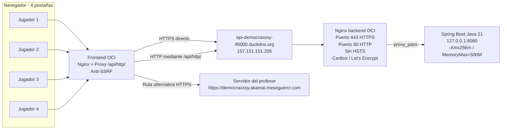

# Guion cronometrado — Demostración y defensa en vivo

## Proyecto

**Cards for democraXSSy** — Curso IF-6000 Redes en los Negocios  
Equipo: **José Andrés** (backend), **Joel** (infraestructura y DevOps) y **Paolo** (frontend, mazos y documentación).

Duración total obligatoria: **15:00 minutos**.

## Resumen ejecutivo y distribución de tiempos

| Bloque | Responsable principal | Herramienta / vista | Duración |
|---|---|---|---:|
| 1. Diagrama de arquitectura | Joel | Diapositiva o terminal con el diagrama | 2.0 min |
| 2. Partida completa por HTTPS directo | Paolo conduce; José Andrés apoya | 4 pestañas del navegador; `IndicadorConexion`; `Ronda.tsx` | 4.0 min |
| 3. Partida por HTTP vía proxy | Paolo | 4 pestañas o 1 pestaña; `Configuracion.tsx`; `IndicadorConexion` | 2.0 min |
| 4. Interoperabilidad con el servidor del profesor | José Andrés | Navegador con un flujo básico del juego | 1.5 min |
| 5. Red y `CallPanel` | José Andrés | DevTools, pestaña **Network** y `CallPanel` | 1.5 min |
| 6. Errores HTTP `409` | José Andrés | Interfaz y PowerShell / consola `curl.exe` | 1.5 min |
| 7. Terraform y monitoreo OCI | Joel | Terminal en `infra/`; consola web de OCI | 1.5 min |
| 8. Defensa y cierre | Equipo completo | Tabla de preguntas probables | 1.0 min |
| **Total** | | | **15.0 min** |

### Checklist técnico previo a la defensa

- [ ] **Cuatro pestañas preparadas**: una por jugador, con la sesión limpia y el `sessionStorage` listo para demostrar jugadores independientes.
- [ ] Frontend disponible y una pestaña abierta en **Configuración** (`frontend/src/screens/Configuracion.tsx`).
- [ ] Sesión SSH/OCI abierta contra la VM `democraxssy-back-e2` y el panel de Oracle Cloud Infrastructure preparado.
- [ ] DevTools abierto en una pestaña de juego; **Network** activa, **Disable cache** marcado y filtros vacíos.
- [ ] Verificar antes de comenzar:

```powershell
curl.exe -I https://api-democraxssy-if6000.duckdns.org/api/salud
curl.exe -I http://api-democraxssy-if6000.duckdns.org/api/salud
```

Ambas comprobaciones deben llegar al servicio activo. El requisito operativo es que `HEAD /api/salud` responda **200** por HTTPS y por HTTP.

## Bloque 1 — Diagrama de arquitectura (2:00)

**Responsable: Joel.** Iniciar exactamente en 0:00 y dedicar 2:00 a explicar el flujo.



### Guion hablado

- **0:00–0:35 — Joel:** “El navegador mantiene una sesión independiente por pestaña mediante `sessionStorage`, así que las cuatro pestañas representan cuatro jugadores reales.”
- **0:35–1:10 — Joel:** “El frontend sirve detrás de Nginx. Una URL `https://` sale directamente al backend y una URL `http://` se reescribe dentro de `frontend/src/api/client.ts` como `/api/http/<host>/<ruta>` para evitar el bloqueo de Mixed Content.”
- **1:10–1:40 — Joel:** “La VM backend usa `VM.Standard.E2.1.Micro`, forma Always Free de OCI. Nginx termina TLS en 443, atiende también 80 sin redirección ni HSTS y reenvía a Spring Boot en `127.0.0.1:8080`. El servicio está limitado a `-Xmx256m` y `MemoryMax=500M`.”
- **1:40–2:00 — Joel:** “El proxy de frontend tiene dos barreras anti-SSRF: una lista de destinos prohibidos en Nginx y reglas `nftables` que impiden al usuario `nginx` alcanzar redes privadas. Para interoperar, el cliente puede cambiar a `https://democraxssy.akamai.meseguercr.com`, que también cumple `openapi.yaml`.”

## Bloque 2 — Partida completa por HTTPS directo (4:00)

**Responsable: Paolo.** Las cuatro pestañas deben seleccionar primero **Nuestro backend (HTTPS)** desde `frontend/src/screens/Configuracion.tsx`. El botón usa el preset definido en `frontend/src/config/servers.ts`.

URL: `https://api-democraxssy-if6000.duckdns.org`

| Tiempo | Acción y explicación |
|---|---|
| 0:00–0:25 | En cada pestaña, abrir la pantalla **Configuración**, pulsar **Nuestro backend (HTTPS)**, escribir un nombre distinto y continuar. El health check debe hacer `HEAD /api/salud` y mostrar **Mesa Verificada** / **Conexión verificada · HTTP 200**. |
| 0:25–0:55 | En la pestaña 1, pulsar **Crear partida nueva** con meta sugerida de 5 puntos. Se ejecuta `POST /api/partidas`. Copiar el ID de partida mostrado en `Ronda.tsx`, en la fase `sala`. |
| 0:55–1:35 | En las pestañas 2, 3 y 4, pulsar **Unirse** e ingresar el ID. Se ejecuta `POST /api/partidas/{id}/jugadores`. Confirmar cuatro jugadores, nombres únicos y el máximo inicial visible. |
| 1:35–1:55 | En la pestaña anfitriona, pulsar el botón de iniciar. Se ejecuta `POST /api/partidas/{id}/iniciar`; el backend reparte siete cartas y comienza una ronda. Señalar que solo inicia con 4 a 22 jugadores y siempre en número par. |
| 1:55–2:35 | En las tres pestañas que no son soberanas, enviar una respuesta con `PUT /api/partidas/{id}/respuestas`. Mostrar la fase `respuestas`, el indicador **“Conexión directa (HTTPS)”** y una carta o nombre escrito deliberadamente como texto tipo `<script>alert('demo')</script>`. Debe verse como texto plano: `Ronda.tsx` usa JSX `{}` y nunca `dangerouslySetInnerHTML`. |
| 2:35–3:05 | Al pasar a `votacion`, cada jugador menos el soberano usa `PUT /api/partidas/{id}/votos`. Señalar la confirmación visual de voto y que está permitido votar por la propia respuesta. |
| 3:05–3:30 | En la pestaña soberana, pasar a `decision` y usar `POST /api/partidas/{id}/decision` para elegir una respuesta, preferiblemente una distinta de la más votada para demostrar la independencia del soberano. |
| 3:30–4:00 | Mostrar `resultado`: se marca `favoritas_del_pueblo`, se registra `respeto_al_pueblo` según si la ganadora estaba entre las favoritas (o si nadie votó) y se muestra la nueva ronda con rotación del soberano al pulsar **Siguiente ronda**, usando `POST /api/partidas/{id}/avanzar`. |

**Frase clave:** “Estas fases están alineadas exactamente con `openapi.yaml`: `sala` → `respuestas` → `votacion` → `decision` → `resultado`, con rotación del soberano y ganador por puntos.”

## Bloque 3 — Partida por HTTP vía proxy (2:00)

**Responsable: Paolo.** Mantener las cuatro pestañas, volver a **Configuración** o cambiar servidor desde **Cambiar servidor** en `Entrada.tsx`, y pulsar **Nuestro backend (HTTP vía proxy)**.

URL: `http://api-democraxssy-if6000.duckdns.org`

- **0:00–0:30:** Pulsar el botón rápido; confirmar que el `backendUrl` queda en `http://api-democraxssy-if6000.duckdns.org`.
- **0:30–0:55:** Explicar que `frontend/src/api/client.ts` transforma `http://host:puerto/ruta` en `/api/http/host:puerto/ruta`. El navegador usa HTTPS con el frontend, por lo que el destino HTTP solo queda detrás del proxy; así no hay error de *Mixed Content*.
- **0:55–1:25:** Verificar en una pestaña activa que `IndicadorConexion.tsx` cambie a **“Conexión vía proxy (HTTP)”** y ejecutar una acción válida, por ejemplo votar o consultar la partida, sin reiniciar la partida.
- **1:25–2:00:** Mostrar que el proxy evita DNS rebinding y destinos privados mediante Nginx y `nftables`. Confirmar que el backend funciona normalmente porque Nginx atiende HTTP en el puerto 80 y no se configuró una redirección 301 ni cabecera HSTS.

**Frase clave:** “HTTP no llega directo al backend desde el navegador; el proxy presenta una llamada HTTPS al usuario y reenvía al HTTP plano permitido por la infraestructura.”

## Bloque 4 — Interoperabilidad con servidor del profesor (1:30)

**Responsable: José Andrés.** Pulsar **Servidor del profesor** en `Configuracion.tsx`.

URL: `https://democraxssy.akamai.meseguercr.com`

- **0:00–0:20:** Seleccionar el preset y ejecutar el health check `HEAD /api/salud`.
- **0:20–0:35:** Confirmar **“Conexión directa (HTTPS)”** en `IndicadorConexion.tsx` y el nuevo destino HTTPS en `CallPanel`.
- **0:35–1:10:** Crear una partida pequeña o unirse a una partida nueva y ejecutar al menos creación, unión y consulta. El flujo debe usar las rutas y DTO definidos en `openapi.yaml`, con nombres y cuerpos JSON compatibles.
- **1:10–1:30:** Señalar que no hay adaptaciones especiales en el frontend: el contrato común obliga a reutilizar estados, Bearer 64-hex, JSON exacto y respuestas `409/413/500` del mismo esquema.

**Nota:** Finalizar el intercambio con una partida que pueda continuar o eliminarse al cerrar la demostración.

## Bloque 5 — Inspección de red y `CallPanel` (1:30)

**Responsable: José Andrés.** Mantener DevTools en Network con caché deshabilitada y abrir `frontend/src/components/CallPanel.tsx`, visible por defecto en `App.tsx`.

### Qué señalar

- Una petición autenticada debe llevar exactamente `Authorization: Bearer <64-hex>`.
- La petición debe usar `Content-Type: application/json` únicamente cuando existe cuerpo.
- Todas las respuestas deben mostrar `Access-Control-Allow-Origin: *`, tanto por HTTPS directo como por HTTP/proxy según la ruta activa.
- Comparar una llamada directa con una llamada vía proxy:
  - Directa: `https://api-democraxssy-if6000.duckdns.org/api/...`
  - Proxy: `https://<frontend>/api/http/api-democraxssy-if6000.duckdns.org/api/...`
- Señalar que Nginx no añade cabeceras como `X-Forwarded-For`, que `axios` no usa cabeceras por defecto y que el token solo se inyecta en rutas que aceptan autenticación.
- En `CallPanel`, señalar columnas **Hora**, **Método**, **Código**, **ms** y **URL**. Pulsar **Limpiar** una vez y repetir una llamada para demostrar que registra método, código y duración en tiempo real.

**Frase clave:** “El panel no reemplaza Network: `CallPanel` hace visible el viaje de cada llamada dentro de la interfaz y Network permite auditar las cabeceras reales.”

## Bloque 6 — Provocación controlada de errores HTTP `409` (1:30)

**Responsable: José Andrés.**

### 6.1 Desde la UI: intentar unir un quinto jugador a una partida iniciada

- Mantener una partida ya iniciada con cuatro jugadores.
- Desde una quinta pestaña, usar el mismo ID e intentar **Unirse** con un nombre distinto.
- Resultado esperado: `409 Conflict` en `POST /api/partidas/{id}/jugadores`, porque ya no está en fase `sala`.
- Señalar el mensaje visible de la interfaz, el banner o `error` de `Ronda.tsx`/`Entrada.tsx`, el código 409 en `CallPanel` y el registro del store de `frontend/src/state/partida.ts`.
- Explicación: además de la regla de fase, el contrato exige 4–22 jugadores en número par y nombres únicos.

### 6.2 Desde consola: una petición estrictamente inválida

Ejecutar desde PowerShell con una partida y un ID reales:

#### Parámetro de consulta prohibido

```powershell
curl.exe -i -X POST `
  -H "Content-Type: application/json" `
  -d "{`"nombre`":`"ConsultaProhibida`",`"puntos_para_ganar`":5}" `
  "https://api-democraxssy-if6000.duckdns.org/api/partidas?test=1"
```

Resultado esperado: `409` y el cuerpo `{"error":"La API no admite parámetros de consulta."}`.

#### Cabecera de sobreescritura prohibida

```powershell
curl.exe -i -X POST `
  -H "Content-Type: application/json" `
  -H "X-HTTP-Method-Override: DELETE" `
  -d "{`"nombre`":`"CabeceraProhibida`",`"puntos_para_ganar`":5}" `
  "https://api-democraxssy-if6000.duckdns.org/api/partidas"
```

Resultado esperado: `409` por una cabecera no permitida.

#### Clave JSON duplicada

```powershell
curl.exe -i -X POST `
  -H "Content-Type: application/json" `
  -d "{`"nombre`":`"Ana`",`"nombre`":`"Beto`",`"puntos_para_ganar`":5}" `
  "https://api-democraxssy-if6000.duckdns.org/api/partidas"
```

Resultado esperado: `409` por detección estricta de claves duplicadas y/o cuerpo JSON inesperado.

**Frase clave:** “El `409` no es solo una acción fuera de fase: el contrato también rechaza parámetros, cabeceras de sobreescritura y JSON con claves repetidas.”

## Bloque 7 — Infraestructura como Código y monitoreo OCI (1:30)

**Responsable: Joel.** Ubicarse dentro de `infra/` y mantener la sesión SSH preparada.

### Terraform

Ejecutar exactamente desde `infra/`:

```powershell
cd infra
terraform plan
```

En pantalla debe verse el plan sincronizado, sin cambios pendientes:

```text
Plan: 0 to add, 0 to change, 0 to destroy.
```

Explicar:

- `infra/compute.tf` declara `oci_core_instance.backend_instance` con `VM.Standard.E2.1.Micro`, Oracle Linux 9 y nombre `democraxssy-back-e2`.
- `infra/public-ip.tf` declara una IP reservada asociada a la VM.
- `infra/cloud-init.yaml` instala Nginx, Java 21, Certbot, usuario sin privilegios, firewall y el servicio systemd.
- `infra/README.md` documenta inicialización, despliegue, certbot y comprobaciones.

### Consola web OCI

Mostrar, durante el mismo bloque:

- Instancia `democraxssy-back-e2` con forma `VM.Standard.E2.1.Micro` en Always Free.
- IP pública reservada `157.151.151.205` y el subdominio DuckDNS asociado.
- Métricas de CPU de la instancia.
- Consumo de memoria, explicando que el sistema tiene 1 GB y que el servicio Java está acotado por `-Xmx256m`, mientras systemd usa `MemoryMax=500M`.

### Comandos opcionales de comprobación remota

```bash
sudo systemctl status democraxssy-back --no-pager
sudo systemctl status nginx --no-pager
free -h
```

No excederse en detalle: 1:30 incluye Terraform y OCI.

## Bloque 8 — Banco de preguntas probables y cierre (1:00)

**Cierre: equipo completo.** Recordatorio: cualquiera puede responder cualquier pregunta; la tabla indica quién lidera la respuesta.

| Pregunta difícil | Respuesta clave resumida | Líder |
|---|---|---|
| ¿Cómo funciona la máquina de estados y qué hace que pase a la siguiente fase? | Fases `sala`, `respuestas`, `votacion`, `decision`, `resultado` y `terminada`; cada acción exige fase, rol y cantidades válidos; las respuestas completas abren votación y los votos completos abren decisión. | José Andrés |
| ¿Por qué cualquier petición desconocida o fuera de contrato responde `409` y no `400`/`422`? | `openapi.yaml` exige rechazo estricto: el backend distingue conflicto de contrato/fase y entrega el esquema `Error`. El 400 se reserva para datos válidos estructuralmente pero inválidos por dominio. | José Andrés |
| ¿Cómo rechazan claves JSON duplicadas? | Jackson está configurado con detección estricta de duplicados para DTOs HTTP; además se rechazan propiedades desconocidas sin afectar `cartas.json`. | José Andrés |
| ¿Por qué Nginx acepta hasta `8k` si el backend limita a 4 KB? | `client_max_body_size 8k` permite que Spring Boot reciba y rechace los cuerpos demasiado grandes con `413` JSON y CORS, en vez de que Nginx corte con una respuesta HTML sin cabeceras. | Joel |
| ¿Cómo manejan concurrencia y memoria sin base de datos? | Estado efímero en estructuras concurrentes dentro de la JVM; sin JDBC ni almacenamiento secundario, con limpieza por inactividad y `ConcurrentHashMap`; reiniciar pierde las partidas activas por diseño. | José Andrés |
| ¿Cómo evitan pérdida de mensajes o condiciones de carrera con varias partidas? | Las mutaciones están encapsuladas y se sincronizan en el modelo de estado compartido, con transición validada de fase y jugador antes de actualizar. | José Andrés |
| ¿Qué es el proxy anti-SSRF y dónde están sus barreras? | Convierte HTTP plano en una ruta segura `/api/http/`, bloquea localhost/IP privadas/metadatos y usa `nftables` para impedir que el usuario `nginx` abra redes privadas aunque el DNS engañe. | Joel |
| ¿Por qué no usan HSTS en este backend? | HSTS impediría demostrar HTTP plano desde el mismo dominio. Nginx sirve HTTP 80 y HTTPS 443 sin redirección ni `Strict-Transport-Security`. | Joel |
| ¿Por qué una VM Always Free de OCI sirve y qué riesgos tiene de capacidad? | Es `VM.Standard.E2.1.Micro`, x86, 1 GB RAM y sin costo recurrente; si queda sin capacidad se usa IaC para recrearla y se conserva la IP reservada. | Joel |
| ¿Cómo protege React contra XSS/CSP? | Nombres y cartas se renderizan como texto con JSX `{}` y no se usa `dangerouslySetInnerHTML`; recursos locales reducen dependencia externa y la CSP evita orígenes/scripts no autorizados. | Paolo |
| ¿Por qué el 409 puede aparecer al usar cabeceras extras o un campo nuevo? | El contrato prohíbe campos desconocidos, parámetros de consulta, cabeceras de método, Authorization en rutas públicas y formatos Bearer inválidos. | José Andrés |
| ¿Cómo demuestra interoperabilidad con el servidor del profesor? | Ambos cumplen `openapi.yaml`, rutas, autenticación, estados, JSON y códigos; el preset cambia solo la base HTTPS y el indicador confirma el modo directo. | Paolo |

### Cierre verbal — últimos 20 segundos

“Demostramos una arquitectura completa: cliente React con contrato estricto, backend Spring Boot Java 21 en memoria, VM OCI administrada con Terraform y Nginx con TLS, HTTP sin HSTS y proxy anti-SSRF. Las restricciones no son decorativas: el `409`, el `413`, las cabeceras CORS y las transiciones de fase forman parte del protocolo.”
